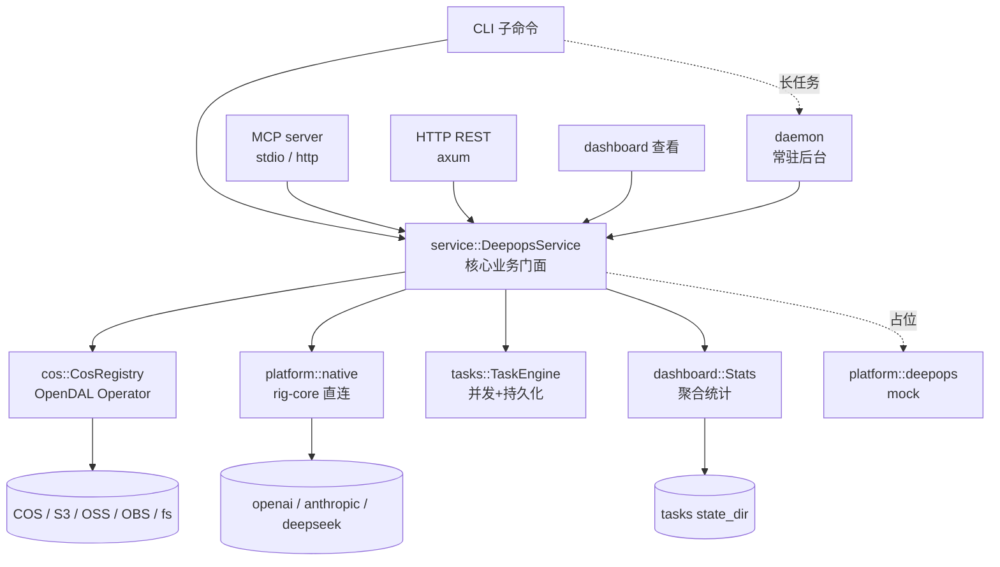
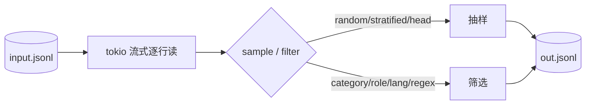
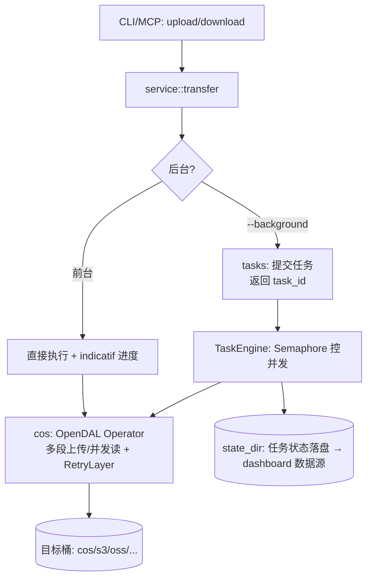
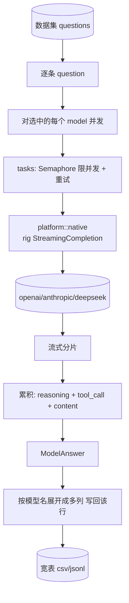
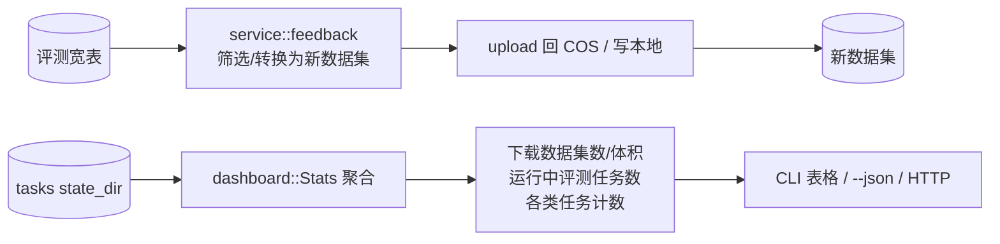

# deepops Rust CLI 技术方案（完整版迁移 + SQLite 定稿）

处理对话数据集的 Rust 命令行程序 + 库（lib）。覆盖：数据上传/下载、抽样筛选、本地/远程评测、评测/训练结果生成、结果回流为新数据集，并提供统计看板。架构对标 `/Users/guobin/tencent/codebrains`，支持多平台、作为 lib 随项目发布、多对象存储平台桶、多 model api key、异步并发任务、MCP + CLI 两种调用方式，并产出 skills 文档。

> 文档状态：已从 `.agents/plans/datasets-rust-cli.md` 完整迁移详细内容，并按当前决策收敛为 **SQLite-only**。  
> 更新时间：2026-10-30

---

## 1. 关键结论（选型已定）

- **双形态**：同一 crate 产出 `lib`（`deepops`）+ `bin`（`deepops`），能力集中在 `service` 层，CLI / MCP / HTTP / dashboard 都是薄壳复用它（对标 codebrains `server/aggregate`）。**lib 随项目一起发布**，不单独发版。
- **对象存储用 Apache OpenDAL**（`opendal` 0.59，MSRV 1.91）：一套 `Operator` API 覆盖腾讯 COS / AWS S3 / 阿里 OSS / 华为 OBS / 本地 fs，按 feature 裁剪后端；自带重试 / 并发限流 / 多段上传 / 可观测层，跨平台跨云。
- **模型调用用 rig（`rig-core` 0.44）**：统一 completion API、流式与 tool calling，覆盖 openai / anthropic / deepseek，不自写 provider HTTP client。
- **本地评测（默认）**：用配置的 model api key 经 rig 直接 query 模型，流式记录中间过程（推理/工具调用轨迹/最终答案/用量/耗时），按模型展开写入宽表列。
- **远程能力（deepops 平台）**：远程评测与 `select --source sql` 取数均经 deepops 平台接口——CLI 只提交参数（引擎/表/日期/渲染后 SQL/limit）并轮询拉取结果，本地不引入任何 SQL 引擎客户端。本期仅留 `trait DeepopsApi` + mock 占位；后续手写 DTO 对接 OpenAPI。
- **统计看板（dashboard）**：查看下载数据集数量/体积、运行中/已完成任务数等，数据来自 tasks 状态聚合。
- **数据库统一为 SQLite（定稿）**：不引入 SurrealDB，避免双后端复杂度。
- **配置与数据库目录统一**：全部落在 `~/.config/deepops/`，按 `dev/prod + version` 子目录隔离。
- **凭据安全**：配置只存 env 变量名，不落明文密钥，运行期解析。

---

## 2. 模块划分（目录结构）

```text
Cargo.toml
rust-toolchain.toml
src/
├── lib.rs
├── main.rs
├── cli.rs
├── error.rs
├── error_codes.rs
│
├── config/
│   ├── mod.rs
│   ├── cos.rs
│   ├── model.rs
│   ├── tasks.rs
│   ├── daemon.rs
│   ├── dashboard.rs
│   └── deepops.rs
│
├── auth/
│
├── database/             # SQLite 元数据层
│   ├── mod.rs
│   ├── sqlite.rs
│   └── models.rs
│
├── cos/
│
├── platform/
│   ├── mod.rs
│   ├── native/
│   │   ├── mod.rs
│   │   ├── providers.rs
│   │   └── answer.rs
│   └── deepops/
│       ├── mod.rs
│       └── dto.rs
│
├── tasks/
├── dashboard/
│   ├── mod.rs
│   └── render.rs
│
├── service/
│   ├── mod.rs
│   ├── record.rs
│   ├── dataset_ops.rs
│   ├── transfer.rs
│   ├── evaluate.rs
│   ├── train.rs
│   ├── feedback.rs
│   └── stats.rs
│
├── daemon/
├── http/
├── mcp/
└── commands/
```

与 codebrains 对应：`service/`≈`server/aggregate`；`daemon/`≈`daemon/`；`mcp/`+`http/`≈`server/`；`platform/native`≈本地引擎；`platform/deepops`≈远程后端。

---

## 3. 依赖选型（SQLite 版）

```toml
# 序列化 / 错误
anyhow = "1"
thiserror = "2"
serde = { version = "1", features = ["derive", "rc"] }
serde_json = "1"
toml = "1"
csv = "1"

# 异步运行时
tokio = { version = "1", features = ["rt-multi-thread","macros","io-util","net","sync","time","signal","process","fs"] }
tokio-util = { version = "0.7", features = ["io"] }
futures = "0.3"
async-trait = "0.1"
bytes = "1"

# 对象存储
opendal = { version = "0.59", features = ["services-cos","services-s3","services-fs"] }

# 模型
rig-core = "0.44"

# CLI / 配置
clap = { version = "4", features = ["derive"] }
dirs = "6"
humantime = "2"
indicatif = "0.17"

# HTTP + MCP
reqwest = { version = "0.12", default-features = false, features = ["json","gzip","http2","rustls-tls"] }
axum = "0.8"
rmcp = { version = "3", features = ["server"] }   # 3.x；stdio / streamable-http transport 在实现步骤 11 按需开 feature；schemars 用 rmcp 内置，不再单独依赖
url = "2"

# 并发 / 数据结构
dashmap = "6"
parking_lot = "0.12"
arc-swap = "1"
once_cell = "1"

# 跨平台系统工具
interprocess = { version = "2", features = ["tokio"] }
fd-lock = "4"

# 日志
tracing = "0.1"
tracing-subscriber = { version = "0.3", features = ["env-filter"] }

# 工具
rand = "0.8"
uuid = { version = "1", features = ["v4"] }
walkdir = "2"
globset = "0.4"
regex = "1"

# SQLite（定稿）：tokio-rusqlite 0.7 携 bundled SQLite 并 re-export rusqlite，不再单独依赖 rusqlite
tokio-rusqlite = { version = "0.7", features = ["bundled"] }

[dev-dependencies]
tempfile = "3"

[profile.release]
lto = "thin"
codegen-units = 1
strip = true
```

选型取舍：
- 模型走 `rig-core`，避免重复维护 provider 协议差异。
- 存储走 `opendal`，统一多云对象存储 API。
- `reqwest` 仅保留给 deepops 后续对接。
- 数据库固定 SQLite，不保留 SurrealDB 分支。

---

## 4. 配置设计（`config/`）

分层优先级建议：
`--config <path>` > `~/.config/deepops/<mode>/<version>/config.toml` > 内置默认。

目录规范（强约束）：

```text
~/.config/deepops/
├── dev/
│   └── v1/
│       ├── config.toml
│       ├── metadata.db
│       ├── tasks/
│       └── logs/
└── prod/
    └── v1/
        ├── config.toml
        ├── metadata.db
        ├── tasks/
        └── logs/
```

路径约定：
- SQLite：`~/.config/deepops/<mode>/<version>/metadata.db`
- 配置：`~/.config/deepops/<mode>/<version>/config.toml`
- 任务状态：`~/.config/deepops/<mode>/<version>/tasks/`
- 默认：`mode=prod`，`version=v1`

配置样例：

```toml
[app]
mode = "prod"                 # dev | prod
version = "v1"

[tasks]
max_concurrency = 8
state_dir = "~/.config/deepops/prod/v1/tasks"

[database]
sqlite_path = "~/.config/deepops/prod/v1/metadata.db"

[daemon]
enabled = false
socket_name = "deepops"

[dashboard]
http = "127.0.0.1:7070"

[[cos]]
name = "default"
platform = "cos"              # cos | s3 | oss | obs | fs
region = "ap-guangzhou"
bucket = "my-bucket-1250000000"
endpoint = "https://cos.ap-guangzhou.myqcloud.com"
secret_id_env = "COS_SECRET_ID"
secret_key_env = "COS_SECRET_KEY"

[[model]]
name = "gpt-5-5"
provider = "openai"
base_url = "https://api.openai.com/v1"
model_id = "gpt-5.5"
api_key_env = "OPENAI_API_KEY"

[[model]]
name = "opus-4-8"
provider = "anthropic"
base_url = "https://api.anthropic.com"
model_id = "claude-opus-4-8"
api_key_env = "ANTHROPIC_API_KEY"

[[model]]
name = "deepseek-v3"
provider = "deepseek"
base_url = "https://api.deepseek.com"
model_id = "deepseek-chat"
api_key_env = "DEEPSEEK_API_KEY"

[deepops]
base_url = "https://<deepops-eval-site>/api"
token_env = "DEEPOPS_TOKEN"
```

---

## 5. 持久化模型（SQLite）

核心表：
1. `tasks`：任务生命周期、payload/progress/error、`idempotency_key` 唯一索引  
2. `datasets`：数据集元信息  
3. `eval_runs`：评测运行实例  
4. `artifacts`：产物索引（csv/jsonl/log）  
5. `schema_migrations`：迁移版本

存储接口（示意）：

```rust
trait SqliteStore {
    async fn create_task(&self, task: TaskRecord) -> Result<()>;
    async fn update_task(&self, id: &str, patch: TaskPatch) -> Result<()>;
    async fn list_tasks(&self, q: TaskQuery) -> Result<Vec<TaskRecord>>;
    async fn upsert_dataset(&self, ds: DatasetRecord) -> Result<()>;
    async fn create_eval_run(&self, run: EvalRunRecord) -> Result<()>;
    async fn append_artifact(&self, a: ArtifactRecord) -> Result<()>;
}
```

SQLite 工程约束：
- PRAGMA：`WAL` / `synchronous=NORMAL` / `foreign_keys=ON` / `busy_timeout=5000`
- 并发：单写多读；长事务分批提交
- 迁移：只做前向兼容增量迁移

---

## 6. 业务流程图

### 6.1 整体调用路径



### 6.2 数据准备：抽样 / 筛选



### 6.3 上传 / 下载



### 6.4 本地评测：rig 流式 → 多列宽表



每个模型展开列（`<slug>`=下划线规范化模型名）：
- `answer_<slug>`
- `reasoning_<slug>`
- `tool_calls_<slug>`
- `finish_reason_<slug>`
- `latency_ms_<slug>`
- `prompt_tokens_<slug>`
- `completion_tokens_<slug>`

### 6.5 结果回流 + 统计看板



---

## 7. CLI 命令面（`cli.rs` + `commands/`）

全局参数：

- `-c, --config <path>`：指定配置文件路径（最高优先级）
- `--mode <dev|prod>`：运行模式（覆盖配置中的 `app.mode`）
- `--json`：以 JSON 输出结果
- `-v, --verbose`：提高日志级别（可重复）

### 7.1 `dataset` 数据集操作命令

| 命令 | 功能 | 主要参数 |
|---|---|---|
| `deepops dataset select` | 统一取数入口（SQL 或文件） | `--source <sql\|file>`；`--out <file>`；`--limit <N>`；`--dry-run` |
| `deepops dataset transform <input>` | 统一数据变换入口（筛选 + 条件组 + 抽样） | `--where <expr>`（可重复）；`--conditions-file <json>`；`--group-logic <and\|or>`；`--sample <N>`；`--sample-strategy <random\|stratified\|head>`；`--seed <u64>`；`--out <file>`；`--validate-only` |
| `deepops dataset upload <local>` | 上传本地文件到对象存储 | `--cos <cos://name/key>`（必填）；`--concurrency <N>` 并发度；`--background` 后台任务 |
| `deepops dataset download <local>` | 下载对象到本地 | `--cos <cos://name/key>`（必填）；`--concurrency <N>` 并发度；`--background` 后台任务；`--overwrite` 允许覆盖本地文件 |

**对象存储地址统一为 URI**：`cos://<存储名>/<对象键>`。`存储名` 对应配置 `[[cos]] name`，省略（`cos:///key`）时取 `default`。
`dataset upload/download` 与 `eval run --cos` 共用同一解析类型 `cos::CosUri`，格式错误（缺 `cos://` 前缀、缺对象键、键为空）在参数解析阶段即报错。
旧的 `--cos <name> --remote <key>` 两参数写法已移除。

#### 7.1.1 `deepops dataset select`（统一取数）

使用两种模式，参数互斥更清晰：

- `--source sql`：从 SQL 数据源取数（注意：不叫 `--mode`，避免与全局 `--mode <dev|prod>` 撞名）
- `--source file`：从本地/COS 文件取数（jsonl/csv/parquet）

> **执行路径（已定）**：`--source sql` 的执行在 **deepops 平台侧**完成——CLI 渲染模板后把 `engine / table / date / SQL / limit` 提交给平台接口，轮询任务状态、拉取结果写 `--out`。本地不引入 SQL 引擎客户端与引擎认证；SQL 方言由平台侧引擎决定（默认模板为 Hive 方言，切引擎需换模板）。本期该链路占位（`trait DeepopsApi` + mock），先落地模板渲染与 `--dry-run`。

`--source sql` 时参数：

- `--engine <hive|spark-sql|trino|presto|custom>`
- `--table <name>`
- `--date <YYYYMMDD>`
- `--sql-file <path>`（可选，自定义 SQL 模板）
- `--param key=value`（可重复，模板参数）
- `--limit <N>`
- `--dry-run`（只渲染 SQL，不执行）

默认 SQL 模板（`${table}` / `${date}` / `${limit}` 参数化）：

```sql
select
    cid,
    traceid,
    queryindex,
    convidx,
    prompt,
    length(prompt) as prompt_len,
    answer,
    length(answer) as answer_len,
    chatmodelid,
    chatmodel_type,
    output_category1,
    output_category2,
    output_category3,
    realpluginid,
    intentpluginid,
    is_search,
    is_deep_seek,
    mas_intent_v2_1st,
    mas_intent_v2_2nd,
    like_cnt,
    unlike_cnt,
    copy_cnt,
    share_cnt,
    is_stopgenerate,
    click_regen_cnt
from ${table}
where ftime = ${date}
  and length(prompt) > 0
distribute by rand()
limit ${limit}
```

示例：

```bash
deepops dataset select \
  --source sql \
  --engine hive \
  --table dwd.xxx_conversation \
  --date 20261030 \
  --limit 50000 \
  --out data/sample-20261030.jsonl
```

`--source file` 时参数：

- `--input <path|cos://name/key>`
- `--format <jsonl|csv|parquet>`（可选，默认按扩展名推断）
- `--limit <N>`（可选）
- `--out <file>`

#### 7.1.2 `deepops dataset transform`（筛选 + 条件组 + 抽样）

同一命令内支持两类筛选表达：

- 轻量表达式：`--where`（可重复），如 `--where "lang = 'zh'" --where "length(prompt) > 0"`
- 条件组 JSON：`--conditions-file`（兼容 Workbench 条件组模型）

条件组采用两层逻辑：

- `entiretyLogic`：组间逻辑（AND/OR）
- `group.conjunction`：组内逻辑（AND/OR）

数据结构与 workbench 抽样条件对齐：

```text
IDataFeatureFilter
├─ Conjunction: entiretyLogic
└─ Expressions: [
   { Kind: FILTER_SET,
     FilterSet: {
       Conjunction: group.conjunction,
       Expressions: [
         { Kind: COMPARISON,
           Comparison: { ColumnUid, Operator, ExpectValue/ExpectValues/... } }
       ] } } ]
```

支持算子（与规则映射一致）：

- 文本：`CT`(包含), `NCT`(不包含), `EQ`, `NEQ`
- 数值：`GT`, `GTE`, `LT`, `LTE`
- 长度：`LGT`, `LGTE`, `LLT`, `LLTE`
- 空值：`ISN`, `ISNN`
- 时间：`DTR`(日期范围), `DTREL`(相对日期 1~30)

目标值类型：

- `VALUE`（单值）
- `VALUELIST`（多选列表）
- `VALUEOPTION`（单选字典值）
- `TIME_RANGE`（时间范围）
- `RELATIVE_DATE`（相对日期）

校验规则（执行前）：

1. `ColumnUid` 与 `Operator` 必填
2. 非 `ISN/ISNN` 时目标值必填
3. 数字类算子必须是数字
4. `DTREL` 必须是 1~30 正整数
5. `ftime` + `TIME_RANGE` 最大跨度 3 个月

示例：

```bash
deepops dataset transform training/input.jsonl \
  --conditions-file ./conditions/sampling.json \
  --group-logic and \
  --sample 10000 \
  --sample-strategy stratified \
  --out training/output.jsonl
```

### 7.2 `eval` 评测命令

| 命令 | 功能 | 主要参数 |
|---|---|---|
| `deepops eval run` | 执行模型评测 | `--models <a,b>`（必填）；**数据来源三选一**：`--dataset <id>` / `--file <path>` / `--cos <cos://name/key>`；`--backend <local\|deepops>`（可省略）；`--record <fields>`；`--concurrency <N>`；`--out <file>`；`--background` |
| `deepops eval collect <job_id>` | 汇总评测结果 | `--out <dir>` 输出目录；`--format <json\|table>` 输出格式 |
| `deepops eval feedback <src>` | 将评测结果回流为新数据集 | `--to-cos <name>` 回传对象存储；`--out <file>` 本地输出；`--min-score <f32>` 最低分过滤（如有评分字段） |

> `eval all`（全流程）与 `eval prepare`（数据准备）已删除，评测入口只有 `run` / `collect` / `feedback`。

#### 7.2.1 `eval run` 数据来源与后端

`--dataset` / `--file` / `--cos` **互斥且必选其一**（clap 参数组，解析阶段拦截）：

| 来源 | 含义 | 对应后端 |
|---|---|---|
| `--dataset <id>` | deepops 平台数据集 ID | `deepops` |
| `--file <path>` | 本地评测文件（jsonl/csv） | `local` |
| `--cos <cos://name/key>` | 对象存储上的评测文件 | `local` |

`--backend` 可省略，由数据来源推导；显式指定时必须与来源一致，否则返回 `DEEPOPS_E0009_INVALID_ARGS`：
平台数据集 ID 只有 deepops 平台认识，不能走 `local`；本地/COS 文件由本地引擎（rig 直连模型）处理，不会自动上传给平台，不能走 `deepops`。
（如后续需要"本地文件交给平台评测"，应在 `dataset upload` 后用 `--dataset` 引用，而不是放宽此规则。）

```bash
deepops eval run --dataset ds-123 --models deepseek-v4-pro,glm-5.3
deepops eval run --file test.jsonl --models deepseek-v4-pro
deepops eval run --cos cos://my-bucket/eval/test.jsonl --models glm-5.3
```

### 7.3 运行态与服务命令

| 命令 | 功能 | 主要参数 |
|---|---|---|
| `deepops dashboard` | 查看统计看板（非 HTML） | `--json` JSON 输出；`--http <addr>` 启动 HTTP JSON 端点（如 `127.0.0.1:7070`） |
| `deepops task list` | 列任务 | `--status <pending\|running\|done\|failed\|canceled>` 状态过滤；`--limit <N>` 条数 |
| `deepops task status <id>` | 查任务详情 | `--json` JSON 输出 |
| `deepops task cancel <id>` | 取消任务 | `--force` 强制取消（仅管理员/调试场景） |
| `deepops`（无子命令） | 默认启动后台守护进程（等价 `deepops daemon start`） | `--socket-name <name>` 可通过显式 daemon 子命令传入 |
| `deepops daemon start` | 启动后台守护进程 | `--socket-name <name>` 覆盖默认 socket |
| `deepops daemon stop` | 停止守护进程 | `--graceful-timeout <secs>` 优雅退出超时 |
| `deepops daemon status` | 查看守护进程状态 | `--json` JSON 输出 |
| `deepops mcp` | 启动 MCP（stdio） | `--transport <stdio>` 默认 stdio |
| `deepops serve` | 启动 HTTP/MCP-HTTP 服务 | `--http <addr>` REST 地址；`--mcp-http <addr>` MCP Streamable HTTP 地址 |

### 7.4 配置命令

| 命令 | 功能 | 主要参数 |
|---|---|---|
| `deepops config show` | 展示当前生效配置 | `--json` JSON 输出；`--redact-secrets` 脱敏显示（默认开启） |
| `deepops config path` | 打印当前配置路径 | 无 |
| `deepops config init` | 初始化默认配置文件 | `--force` 覆盖已有文件 |
| `deepops config set <key> <value>` | 设置配置项 | `--type <auto\|string\|int\|float\|bool\|json>` 值类型 |
| `deepops config unset <key>` | 删除配置项 | 无 |

常用示例：

```bash
deepops config show
deepops config set app.mode dev
deepops config set tasks.max_concurrency 16
deepops config set database.sqlite_path "~/.config/deepops/dev/v1/metadata.db"
deepops config unset deepops.token_env
```

---

## 8. MCP + HTTP 工具面

MCP（rmcp，stdio + streamable-http）工具名 snake_case，schema 用 rmcp 内置 schemars 生成。工具直接调用 `DeepopsService`：
- `dataset_sample`
- `dataset_filter`
- `dataset_upload`
- `dataset_download`
- `dataset_eval`
- `dataset_feedback`
- `dashboard_stats`
- `task_status`

HTTP（axum）暴露同一组 REST 端点（含 `/dashboard`）。

---

## 8.1 配置查看与修改（CLI）

配置支持通过 CLI 直接查看与修改，避免手改 TOML：

- `deepops config show`：展示当前生效配置（可配合 `--json`）
- `deepops config path`：打印当前使用的配置文件路径
- `deepops config init`：初始化默认配置文件
- `deepops config set <key> <value>`：按点路径写入（如 `app.mode`、`tasks.max_concurrency`）
- `deepops config unset <key>`：删除指定键

写入约束：

1. 先解析校验后写回，非法值直接报错，不写盘。
2. 原子写入（临时文件 + rename），避免中断导致坏文件。
3. 修改后立即生效于新进程；daemon 模式通过 reload 或重启生效。

---

## 9. skills 文档产出

`.codebuddy/skills/deepops/SKILL.md`：工具用途、CLI 速查、MCP 工具列表与入参、配置示例、典型工作流（抽样 → 上传 → 本地评测 → 回流 → 看板）。各模块补充简短 `AGENTS.md`。

---

## 10. 实施步骤

1. `Cargo.toml` + `rust-toolchain.toml` + 骨架（lib/main/cli/error*），`cargo build` 空壳通过。
2. `config/`（分层加载 + 多 cos/多 model + dashboard）+ `deepops config init/show/path`。
3. `auth/` 凭据解析（env 引用）。
4. `database/sqlite`（schema + migration + PRAGMA + 仓储接口）。
5. `tasks/` 任务引擎（并发 + 状态落盘 + 幂等键）+ `service/` 门面 + `record.rs`。
6. `service::select(file) / sample / filter` + CLI（纯本地，先打通；`select --source sql` 本期只做模板渲染 + `--dry-run`）。
7. `cos/`（OpenDAL registry，多 platform）+ `service::upload/download`。
8. `platform/` + `platform/native`（rig 流式中间过程）+ `service::evaluate` + `deepops eval run --file/--cos`（local 后端）。
9. `dashboard/`（聚合 tasks 状态）+ `deepops dashboard` + `service::feedback`。
10. `daemon/`（socket + dispatch + 单实例锁）。
11. `mcp/` + `http/`（serve，含 dashboard 端点）。
12. skills 文档 + 各模块 AGENTS.md。
13. `cargo fmt` + `clippy` + `cargo build --release` 验证。

> **进度（2026-10-30）**：步骤 1-2 已完成——骨架 26 个文件编译通过（clippy 0 警告、3 单测过），
> 配置分层加载 + `deepops config show/path/init` 可用，`serve` HTTP 骨架（/healthz + /dashboard 占位）可起；
> `config set/unset` 待做。实现期偏差：依赖调整为 rmcp 3（原 1）/ tokio-rusqlite 0.7（原 rusqlite 0.32 + tokio-rusqlite 0.6），
> 删除独立 schemars 依赖（用 rmcp 内置）；select 的 `--mode` 参数更名 `--source`（与全局 `--mode <dev|prod>` 撞名）。

> `platform/deepops` 本期仅留 trait + mock 占位，不进实现步骤（覆盖远程评测与 `select --source sql` 取数两条链路）；`select` 先落地 `--source file` 与 SQL 模板渲染/`--dry-run`，待平台 OpenAPI 明确后手写 DTO 对接。

---

## 11. 继续 review 的关键改进项

1. **兼容性**：固定 CLI 输出字段与错误码，patch 版本不改 JSON 结构。  
2. **边界条件**：空数据集、超大行、非法 JSONL、模型超时、磁盘写满要有明确错误语义。  
3. **性能基线**：定义吞吐/内存上限基线（如 1GB JSONL 流式处理不爆内存）并在 CI 冒烟。  
4. **安全最小面**：配置仅存 env key 名，日志默认脱敏，不打印 token/AK/SK。  
5. **可维护性**：`service` 只编排；SQL/协议细节下沉到 `database/cos/platform`。  

---

## 12. 待确认（2026-10-30 review）

已确认：CLI/crate/lib 统一命名 `deepops`，配置目录 `~/.config/deepops/<mode>/<version>/`；SQLite 元数据模块目录定为 `database/`（配置节 `[database]`）；取数（`select --source sql`）经 deepops 平台接口执行，CLI 只传参与拉结果，本期 trait + mock 占位；provider = openai/anthropic/deepseek；需要流式记录中间过程；deepops 远程后端本期不实现；数据库仅 SQLite；SQLite 驱动采用 `tokio-rusqlite 0.7`（bundled，re-export rusqlite，不再单独依赖）；对象存储后端启用 `cos + fs + s3`；dashboard 仅保留 CLI 表格 + `--json` + HTTP JSON（不做独立 HTML 看板）。

待补充的设计缺口（按优先级）：

1. **parquet 依赖缺失**：`--format parquet` 已承诺但未引入 `arrow`/`parquet` crate；parquet 读取非逐行流式，需评估大文件内存上限。
2. **`transform --where` 表达式语言未定义**：字段引用、函数（`length()`）、类型推断与比较规则无规格；`ColumnUid`（Workbench 模型）→ 数据集实际字段的映射关系未说明。
3. **任务崩溃恢复语义未定义**：进程重启后 `running` 任务标记失败还是可恢复；`eval` 是否支持断点续跑（按行 checkpoint、幂等重入）。
4. **模型 API 限流策略缺失**：仅 Semaphore 并发不够，需 429/超时的指数退避、单模型失败隔离（不拖垮整个 run）。
5. **错误码清单缺失**：`error_codes.rs` 只有文件名，无码段分配、JSON 错误结构与稳定契约定义（第 11 节要求"固定错误码"但无处落地）。
6. **MCP 工具面与 CLI 不对齐**：`dataset_sample`/`dataset_filter` 对应 CLI `transform`；缺 `select`、`task list/cancel`、`config` 等工具，需明确 parity 策略。
7. **`<version>` 目录与 `schema_migrations` 职责重叠**：版本目录物理隔离数据，迁移又声称前向兼容，二者关系（升级时是否迁移旧库）需明确。
8. **前台操作是否落库未定义**：非 `--background` 的 upload/download 若不写 tasks/datasets 表，dashboard 的"下载数/体积"统计会漏计。
9. **配置目录硬编码 `~/.config`**：应经 `dirs::config_dir()` 解析，否则 Windows（`%APPDATA%`）/macOS 语义不一致。
10. **lib 发布渠道未说明**：crates.io 还是内部 registry；`deepops` 名称在 crates.io 是否可用需确认。
11. **`select --source sql` 平台接口契约待定**（低优，占位期间不阻塞）：提交/轮询/结果回传格式、大结果分页拉取方式，待 deepops 平台 OpenAPI 明确后手写 DTO。
